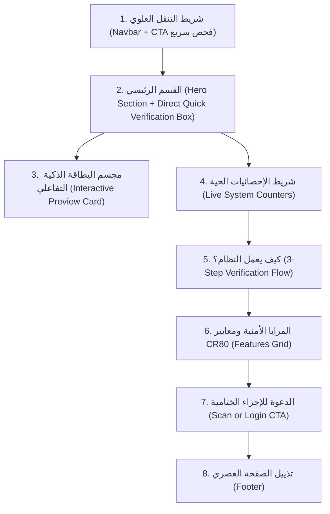

# 🏠 مواصفات وخطة تنفيذ الصفحة الترحيبية (Welcome / Home Page Specification)

> [!NOTE]
> هذه الوثيقة تفصل مكونات وأقسام الصفحة الترحيبية لنظام **Huwia ID** وكيفية قيادتها للمستخدمين ورجال الأمن إلى مسار التحقق السريع من البطاقات.

---

## 🧭 1. الهدف الاستراتيجي للصفحة
تحويل الصفحة الترحيبية من مجرد صفحة هبوط عامة إلى **بوابة دخول وتفاعل فورية** تؤدي وظيفتين أساسيتين:
1. إبراز هوية وموثوقية منصة البطاقات الذكية ومميزاتها الأمنية.
2. تزويد أي زائر أو موظف أمن بإمكانية **التحقق اللحظي المباشر** من أي بطاقة عبر إدخال رقمها في الواجهة أو فتح كاميرا مسح الـ QR بنقرة واحدة.

---

## 📐 2. التشريح التفصيلي لأقسام الصفحة الترحيبية (Section-by-Section Anatomy)



---

### القسم 1: شريط التنقل العلوي (Navigation Bar)
* **المكونات**:
  - شعار النظام: أيقونة البطاقة الذكية مع نص **Huwia ID** بالخط العربي المتناسق.
  - روابط تصفح سريعة: `الرئيسية`، `كيفية الفحص`، `المعايير الأمنية`.
  - زر مميز باللون الأساسي (Primary Button):
    **`مسح رمز QR 📷`** ⬅️ يقود مباشرة إلى الرابط `route('idcard.scanner')`.
  - زر لوحة التحكم: **`تسجيل الدخول الإداري`** ⬅️ يقود إلى لوحة Filament `/admin`.

---

### القسم 2: القسم الرئيسي (Hero Section + Quick Verification Form)
* **النص الرئيسي (Heading)**:
  > **المنصة الذكية لإدارة وطباعة وفحص البطاقات التعريفية الموثقة**
* **النص الفرعي (Subheading)**:
  > تحقق فوري خلال ثوانٍ، تشفير رقمي متقدم يمنع التزوير والاستنساخ، وتوافق تام مع بطاقات CR80 البلاستيكية لكافة المنظمات والشركات.
* **صندوق البحث والتحقق السريع المدمج (Livewire Quick Verification Input)**:
  - يحتوي على خيارين سريعين:
    1. **حقل إدخال مباشر برقم البطاقة**: يكتب فيه المفتش كود البطاقة (مثال: `CRD-2026-XXXX` أو الرقم القومي) مع زر "تحقق الآن".
    2. **زر المسح عبر الكاميرا**: ينقله فوراً لشاشة المسح التفاعلية عبر مسار `/verify-card`.

---

### القسم 3: مجسم البطاقة الذكية التفاعلي (3D / Glassmorphic Card Showcase)
* يظهر إلى جانب نموذج الـ Hero مجسم بطاقة افتراضية أنيق (CR80) يحمل:
  - صورة شخصية مع شارة "معتمدة وموثقة ✅".
  - الاسم الكامل والقسم والهيكل الشجري.
  - رمز الاستجابة السريع QR المشفر.
  - رقم المعرف الأمني الفريد UID.
  - تأثير حركي خفيف (Subtle hover animation) يشعر المستخدم باحترافية النظام.

---

### القسم 4: شريط الإحصائيات الحية (Live Metrics Counter)
يستعلم المكون من قاعدة البيانات ويعرض أرقاماً ديناميكية حية:
* 🪪 **البطاقات النشطة الصادرة**: `Card::where('status', 'active')->count()`
* 🛡️ **عمليات الفحص الأمني المكتملة**: `VerificationLog::count()`
* 🏢 **القطاعات والأقسام المسجلة**: `Department::count()`
* 🔒 **نسبة الحماية من التزوير**: `100% مشفرة بـ HMAC`

---

### القسم 5: كيف يعمل نظام التحقق؟ (How It Works)
شرح بصري في 3 خطوات بسيطة:
1. **الخطوة 1: إصدار البطاقة**: توليد كود أمني وتوقيع رقمي فريد للـ QR عند اعتماد البطاقة.
2. **الخطوة 2: الطباعة المعتمدة**: طباعة بطاقات بلاستيكية مزدوجة الوجهين بأعلى دقة ووضوح.
3. **الخطوة 3: التحقق الفوري**: مسح الكاميرا بكاميرا الهاتف أو قارئ الباركود لعرض حالة الصلاحية فورا.

---

### القسم 6: المزايا التقنية والأمنية (Security & Enterprise Features)
شبكة من 4 كروت بتصميم عصري (Cards Grid):
* **التشفير الرقمي ومكافحة التزوير**: لا يمكن تزييف أو توليد رموز QR خارج المنظومة.
* **هيكل تنظيمي شبكي مرن**: دعم غير محدود للأقسام، الوحدات، والفرق.
* **سجل تدقيق كامل (Audit Logs)**: تسجيل زمان ومكان كل عملية فحص أمني.
* **دعم الطابعات الاحترافية**: توافق مع أجهزة Zebra و Evolis و Fargo وطباعة أوراق A4 المجمعة.

---

### القسم 7: الدعوة للإجراء الختامية (Action Banner)
* بنر جذاب بخلفية داكنة وتدرج لوني يحث موظفي الأمن والجهات على التحقق الفوري:
  - زر رئيسي: **`ابدأ فحص بطاقة الآن`** ⬅️ إلى `/verify-card`.
  - زر ثانوي: **`دخول مسؤولي النظام`** ⬅️ إلى لوحة التحكم الإدارية.

---

## ⚙️ 3. آلية عمل Livewire في الصفحة الترحيبية (`HomePage.php`)

```php
// في الكنترولر التفاعلي المقترح:
public string $cardQuery = '';

public function quickLookup(): void
{
    $token = trim($this->cardQuery);
    if (!empty($token)) {
        $this->redirect(route('idcard.scanner', ['scannedCode' => $token]));
    }
}
```
عندما يقوم المستخدم بإدخال رقم البطاقة والضغط على Enter أو زر "تحقق"، يتم نقله مباشرة إلى صفحة الفحص مع تعبئة الكود تلقائياً وإظهار النتيجة في لحظة واحدة!
