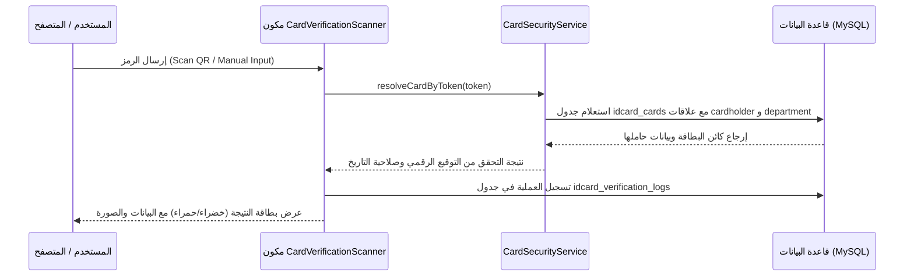

# 🗄️ خريطة ربط قاعدة البيانات والخدمات (Database & Services Mapping)

> [!NOTE]
> هذا الملف يوضح كيف تتكامل جداول قاعدة البيانات والخدمات الأمنية في حزمة [`Packages/IdCard`](file:///c:/laragon/www/id-ceard-sys/Packages/IdCard) مع الصفحة الترحيبية وصفحة الفحص.

---

## 📊 1. خريطة استعلامات الصفحة الترحيبية (Home Page Database Mapping)

| العنصر في الصفحة الترحيبية | الجدول المستعلم منه | الاستعلام / الحقل المستخدم |
| :--- | :--- | :--- |
| **اسم وشعار المنصة** | `settings` / `idcard_organizations` | `settings()->company_name` و `logo_path` |
| **عداد البطاقات النشطة** | `idcard_cards` | `Card::where('status', 'active')->count()` |
| **عداد عمليات التحقق المكتملة** | `idcard_verification_logs` | `VerificationLog::where('verification_status', 'valid')->count()` |
| **عداد الأقسام والتصنيفات** | `idcard_departments` | `Department::where('is_active', true)->count()` |
| **صندوق التحقق السريع** | `idcard_cards` & `idcard_cardholders` | البحث بواسطة `card_uid` أو `card_number` أو `qr_token` |
| **روابط لوحات التحكم** | `users` & `filament` | `filament()->getPanel('admin')->getLoginUrl()` |

---

## 🔍 2. خريطة استعلامات صفحة الفحص (Verification Page Database Mapping)

عند استلام رمز الـ QR أو رقم البطاقة في صفحة الفحص:

### الحقول المسجلة في جدول الفحص (`idcard_verification_logs`):
* `card_id`: معرف البطاقة (أو NULL إذا كان الرمز مزوراً/غير مسجل).
* `scanned_token`: الرمز الممسوح للرجوع إليه عند التدقيق.
* `verification_status`: (`valid`، `expired`، `revoked`، `invalid_token`).
* `scanner_ip`: عنوان الـ IP للجهاز الفاحص.
* `user_agent`: تفاصيل المتصفح ونظام التشغيل.
* `device_type`: (Mobile / Desktop / Hardware Scanner).
* `scanned_at`: تاريخ ووقت العملية بدقة الثواني.

---

## 🔐 3. الخدمات المستخدمة في المنظومة (Core Services)

1. **[`CardSecurityService`](file:///c:/laragon/www/id-ceard-sys/Packages/IdCard/Services/CardSecurityService.php)**:
   - `generateCardUid()`: توليد معرف بطاقة فريد بصيغة `CRD-YYMMDD-XXXXXX`.
   - `generateQrToken()`: توليد التوقيع الرقمي المشفر للـ QR عبر `hash_hmac('sha256', ...)`.
   - `resolveCardByToken()`: فك الشفرة واستخراج البطاقة المطابقة.

2. **[`CardPrintService`](file:///c:/laragon/www/id-ceard-sys/Packages/IdCard/Services/CardPrintService.php)**:
   - `mmToPixels()`: تحويل أبعاد البطاقة القياسية CR80 (85.6mm × 54mm) إلى بكسل بدقة 300 DPI للطباعة والتصميم.
   - `calculateA4Layout()`: تقسيم صفحات الطباعة المجمعة إلى شبكة من 8 أو 10 بطاقات للورقة الواحدة.
